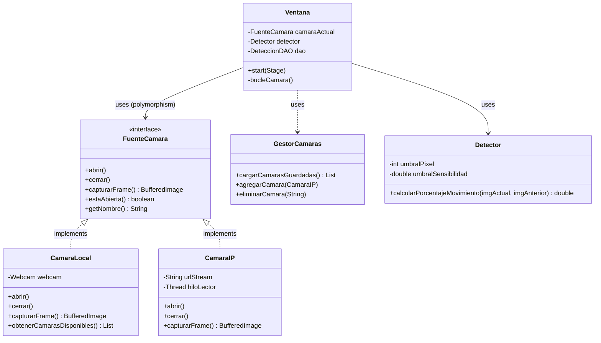

<div align="center">

# FrameDiff Security System

**Real-time motion detection and video surveillance, built from scratch in Java.**


</div>

---

## Overview

FrameDiff Security System monitors video feeds, detects movement inside a user-defined zone, and reacts: it sounds an acoustic alarm, captures photo evidence, writes the event to an interactive live log, and records the event in a SQL Server database.

Detection is powered by a **custom frame-differencing engine** that compares consecutive grayscale frames pixel by pixel without depending on heavy third-party computer vision libraries.

The system supports **multiple video sources**:
1. **Local cameras** (integrated laptop webcams and USB webcams).
2. **Remote WiFi / IP cameras** (smartphones running IP webcam applications or dedicated network cameras) streaming MJPEG over HTTP.

Developed for the Object-Oriented Programming course at Universidad Tecnológica del Perú (UTP).

---

## How It Works

```text
  Video Source: Local Webcam or Remote WiFi / IP Camera (MJPEG)
                           |
                           v
          Dynamic Aspect Ratio & Auto-Resolution
                           |
                           v
                  Grayscale conversion
                           |
                           v
           Frame differencing  <--  previous frame
                           |
                           v
                ROI filter (X, Y limits)
                           |
                           v
        Threshold check (per-pixel difference + sensitivity)
                           |
         +-----------------+-----------------+-----------------+
         |                 |                 |                 |
         v                 v                 v                 v
    Audio alarm        Event log      Evidence snapshot  Database record
(javax.sound.sampled)  (live UI)    (disk, max 1 / 5s)  (SQL Server via JDBC)
```

---

## Features

| Feature | Details |
|---|---|
| **Multi-Source Video** | Supports local integrated/USB webcams and remote WiFi/IP cameras (e.g. smartphones) seamlessly |
| **Camera Persistence** | Save and delete configured WiFi/IP cameras with automatic local persistence in `camaras.properties` |
| **Detection Engine** | Custom pixel-matrix difference calculation with configurable per-pixel delta and global sensitivity |
| **Dynamic ROI** | Real-time Region of Interest adaptation; bounds adjust automatically to the connected camera's resolution |
| **Aspect Ratio Preservation** | Feeds (16:9 widescreen or 4:3 standard) scale cleanly without distortion or clipping |
| **Acoustic Alerts** | Audio alarm triggered immediately on intrusion events |
| **Evidence Capture** | Automated snapshot saved to disk under `Evidencias/` when movement is verified |
| **Event Log** | Real-time audit panel in the interface documenting initialization, camera switches and alerts |
| **Database Logging** | Every detection (timestamp, movement percentage, evidence path) is persisted in SQL Server |
| **Non-blocking Execution** | Database operations and network video streaming run on dedicated background threads |
| **Anti-flood Cooldown** | Disk writes and database records are throttled to at most one every 5 seconds |

---

## OOP Architecture

The project emphasizes core Object-Oriented Programming design principles: **Polymorphism**, **Abstraction**, **Encapsulation**, and the **Dependency Inversion Principle (DIP)**.



### Class Responsibilities

| Class / Interface | Type | Responsibility |
|---|---|---|
| `FuenteCamara` | Interface | Common abstraction for any video input device (local or network) |
| `CamaraLocal` | Class | Concrete implementation wrapping local webcams via Sarxos Webcam API |
| `CamaraIP` | Class | Concrete implementation handling remote MJPEG/HTTP streams with concurrent frame retrieval |
| `GestorCamaras` | Class | Manages persistence (save, load, delete) for configured network cameras |
| `Detector` | Class | Custom matrix difference engine, threshold checks and dynamic ROI boundaries |
| `Ventana` | Class | JavaFX graphical interface, camera selector, real-time rendering and event management |
| `DeteccionDAO` | Class | Data Access Object: connects via JDBC and asynchronously inserts detection logs |
| `Main` | Class | Application entry point |

### Principles in Action

* **Polymorphism & Inversion of Control:** `Ventana` interacts exclusively with the `FuenteCamara` interface. It does not know or care whether a feed comes from a USB webcam or a smartphone streaming across the local WiFi network.
* **Separation of Concerns:** Video acquisition, image processing (`Detector`), data persistence (`DeteccionDAO`), and graphical presentation (`Ventana`) are decoupled.
* **Concurrency & Non-blocking I/O:** MJPEG network stream parsing runs in a daemon thread inside `CamaraIP` to avoid UI stutter and prevent frame buffer accumulation. Database writes are handled on a separate `ExecutorService`.
* **Safe Secrets & Environment Isolation:** Database connection details and camera network URLs are decoupled from the code in `.properties` files ignored by Git.

---

## Project Structure

```text
FrameDiff-Security-System/
├── src/
│   ├── Main.java                   # Entry point
│   ├── FuenteCamara.java           # Video source interface (Abstraction)
│   ├── CamaraLocal.java            # Local webcam implementation
│   ├── CamaraIP.java               # Network/WiFi camera implementation (MJPEG)
│   ├── GestorCamaras.java          # Camera persistence manager
│   ├── Detector.java               # Motion detection engine
│   ├── Ventana.java                # Graphical user interface (JavaFX)
│   └── DeteccionDAO.java           # Database access layer (JDBC)
├── lib/                            # External dependencies (Sarxos, SLF4J, BridJ, mssql-jdbc)
├── recursos/
│   ├── alarma.wav                  # Acoustic alert sample
│   └── estilos.css                 # Dark Gruvbox-inspired UI stylesheet
├── schema.sql                      # SQL Server database creation script
├── config.example.properties       # Database configuration template
├── camaras.example.properties      # Network camera list template
└── README.md
```

---

## Getting Started

### Prerequisites
* JDK 17 or higher
* [JavaFX SDK](https://openjfx.io/) (matching your JDK version)
* SQL Server with TCP/IP enabled (default port: 1433)
* A local webcam or a mobile phone connected to the same WiFi network

---

### Step 1: Clone and Prepare Configuration

```bash
git clone https://github.com/JLoayz/FrameDiff-Security-System.git
cd FrameDiff-Security-System
```

1. **Database configuration:** Copy `config.example.properties` to `config.properties` and add your database credentials:
   ```properties
   db.url=jdbc:sqlserver://localhost:1433;databaseName=SecuritySystem;encrypt=true;trustServerCertificate=true
   db.user=YOUR_USER
   db.password=YOUR_PASSWORD
   ```
2. **Database setup:** Execute `schema.sql` in SQL Server (SSMS, Azure Data Studio, DBeaver or `sqlcmd`) to create the database and `SystemLogs` table.

---

### Step 2: Running the Application

#### Option A: Using your IDE (Recommended)
1. Open the project in IntelliJ IDEA, Eclipse, or NetBeans.
2. Ensure the JDK is set to 17+.
3. Add the `.jar` files in the `lib` folder and the JavaFX SDK to the project dependencies.
4. Mark `recursos` as a **Resources Root**.
5. Run `Main.java`.

#### Option B: From Command Line
```bash
# Compile
javac --module-path /path/to/javafx/lib --add-modules javafx.controls,javafx.swing \
      -cp "lib/*:src" -d out src/*.java

# Run (Linux)
java --module-path /path/to/javafx/lib --add-modules javafx.controls,javafx.swing \
     -cp "out:recursos:lib/*" Main

# Run (Windows: use ; as the classpath separator)
java --module-path C:\path\to\javafx\lib --add-modules javafx.controls,javafx.swing ^
     -cp "out;recursos;lib/*" Main
```

---

### Step 3: Connecting a WiFi / IP Camera (Smartphone)

1. Install an app like **IP Webcam** (Android) or **IP Camera Lite** (iOS).
2. Connect your phone to the same WiFi network as your laptop.
3. Start the server in the app (e.g. `http://192.168.1.35:8080`).
4. In the application, click **`+ WiFi`**, name it (e.g. *Cámara Celular*), and enter `http://<PHONE_IP>:8080/video`.
5. The camera is saved automatically for future sessions. Select it in the dropdown and click **ENCENDER**.

---

<details>
<summary><b>Resumen en español</b></summary>

<br>

**FrameDiff Security System** es un sistema de videovigilancia y detección de movimiento en tiempo real, desarrollado en Java para el curso de Programación Orientada a Objetos (UTP, 2026).

### Características y Diseño POO
* **Soporte Multi-Cámara (Local y WiFi/IP):** Permite conectarse tanto a la webcam integrada de la laptop como a cámaras remotas de red o smartphones vía WiFi mediante el protocolo estándar MJPEG sobre HTTP (`http://IP:PUERTO/video`).
* **Polimorfismo e Inversión de Dependencias:** La interfaz `FuenteCamara` desacopla completamente el motor de detección de los dispositivos físicos. Las clases `CamaraLocal` y `CamaraIP` implementan este contrato común de manera polimórfica.
* **Persistencia de Cámaras (`GestorCamaras`):** Permite registrar nuevas cámaras WiFi con el botón `+ WiFi` y guardarlas de forma permanente en `camaras.properties`, así como eliminarlas con el botón `- Borrar`.
* **Adaptación Dinámica y Preservación de Aspect Ratio:** Detección automática de la resolución real de la cámara (4:3 o 16:9 panorámico) ajustando los límites de la Región de Interés (ROI) y evitando distorsiones o recortes en pantalla.
* **Sin librerías pesadas de visión artificial:** La matriz de diferencia de frames y el cálculo de umbrales están desarrollados desde cero en Java puro.

</details>

---

## Author

**Jairo Loayza** | Systems & Computer Science student, UTP, 2026

[LinkedIn](https://www.linkedin.com/in/jairo-loayza)
