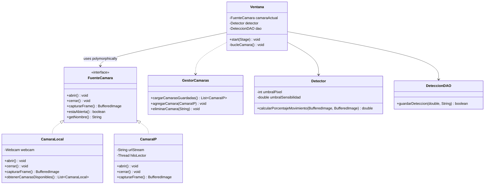

<div align="center">

# FrameDiff Security System

**Real-time motion detection and video surveillance, built from scratch in Java.**


</div>

---

## Contents

- [Overview](#overview)
- [How it works](#how-it-works)
- [Features](#features)
- [OOP architecture](#oop-architecture)
- [Project structure](#project-structure)
- [Configuration](#configuration)
- [Getting started](#getting-started)
- [Using the application](#using-the-application)
- [Troubleshooting](#troubleshooting)
- [Known limitations](#known-limitations)
- [Resumen en español](#resumen-en-español)
- [Author](#author)

---

## Overview

FrameDiff Security System monitors a live video feed, detects movement inside a user-defined region of interest (ROI), and reacts immediately: it sounds an alarm, appends an entry to the on-screen log, saves a photo as evidence, and records the event in a SQL Server database.

Detection is powered by a **custom frame-differencing engine**: consecutive frames are compared pixel by pixel using luminance derived from RGB, with no heavyweight computer-vision library involved.

Two kinds of video source are supported through a single interface:

1. **Local cameras** — integrated laptop webcams and USB webcams (Sarxos Webcam API).
2. **Remote WiFi / IP cameras** — smartphones running an IP-webcam app, or dedicated network cameras streaming MJPEG over HTTP.

Developed for the Object-Oriented Programming course at Universidad Tecnológica del Perú (UTP).

---

## How it works

```text
  Video source: local webcam or remote MJPEG stream (HTTP)
                |
                v        FuenteCamara.capturarFrame()
           BufferedImage
                |
                +-------------------> JavaFX preview (aspect ratio preserved)
                |
                v
  ROI bounds (X/Y inicio/fin), clamped to the frame size
                |
                v
  Per-pixel grayscale difference vs. previous frame  <-- previous frame
                |
                v
  percentage > sensitivity threshold ?
        | no                    | yes
        v                       v
  update previous frame    alarm + live log
                           evidence snapshot (max 1 / 5 s)
                           INSERT into SQL Server (max 1 / 5 s)
```

Frames are compared at their native resolution. IP streams wider than 1280 px are downscaled first to keep processing responsive. Everything runs on background threads: MJPEG parsing lives inside `CamaraIP`, and database inserts run in a single-thread `ExecutorService`; only UI updates are marshalled back with `Platform.runLater`.

---

## Features

| Feature | Details |
|---|---|
| **Multi-source video** | Local webcams and remote WiFi/IP cameras through the same `FuenteCamara` contract |
| **Camera persistence** | Add and delete WiFi/IP cameras from the UI; saved automatically in `camaras.properties` |
| **Custom detection engine** | Frame differencing with a per-pixel delta (`umbralPixel`) and a global percentage threshold (`umbralSensibilidad`) |
| **Dynamic ROI** | Bounds are reset to the connected camera's real resolution and can be edited while the system runs |
| **Aspect-ratio preservation** | 16:9 and 4:3 feeds are displayed without distortion or clipping |
| **Acoustic alerts** | Alarm sample played through `javax.sound.sampled` when motion exceeds the threshold |
| **Evidence capture** | Snapshot written to `Evidencias/` when an alert is confirmed (throttled to one per 5 seconds) |
| **Live event log** | On-screen audit panel for startup, shutdown, camera changes, and alerts |
| **Database logging** | Confirmed alerts are inserted asynchronously into SQL Server with their movement level and evidence path |
| **Non-blocking I/O** | Network streaming and database writes run off the JavaFX application thread |
| **Anti-flood cooldown** | Disk writes and database inserts are limited to one every 5 seconds |

---

## OOP architecture

The project emphasizes **abstraction, polymorphism, encapsulation, and the Dependency Inversion Principle (DIP)**.



### Class responsibilities

| Class / interface | Role |
|---|---|
| `FuenteCamara` | Common abstraction for any video input device (local or network) |
| `CamaraLocal` | Local webcam implementation wrapping the Sarxos Webcam API |
| `CamaraIP` | MJPEG-over-HTTP implementation with a dedicated reader thread and frame parsing |
| `GestorCamaras` | Persistence (load, add, delete) of configured network cameras |
| `Detector` | Frame-difference engine, luminance thresholds, and ROI clamping |
| `DeteccionDAO` | JDBC data-access layer for asynchronous insert of detection records |
| `Ventana` | JavaFX UI, camera selector, live rendering, alarm, and event coordination |
| `Main` | Application entry point |

### Principles in action

* **Polymorphism / inversion of control:** `Ventana` works only with `FuenteCamara`; it does not care whether frames come from a USB webcam or a phone across the WiFi network.
* **Separation of concerns:** acquisition, image analysis, persistence, and presentation are independent classes.
* **Concurrency:** MJPEG parsing and database writes run on background threads; UI changes are scheduled on the JavaFX thread.
* **Configuration outside the code:** database credentials and camera URLs live in `.properties` files that are ignored by Git.

---

## Project structure

```text
FrameDiff-Security-System/
├── src/
│   ├── Main.java                   # Entry point
│   ├── FuenteCamara.java           # Video source interface (abstraction)
│   ├── CamaraLocal.java            # Local webcam implementation
│   ├── CamaraIP.java               # Network/WiFi camera implementation (MJPEG)
│   ├── GestorCamaras.java          # Camera persistence manager
│   ├── Detector.java               # Motion detection engine
│   ├── Ventana.java                # JavaFX UI and event loop
│   └── DeteccionDAO.java           # JDBC data access layer
├── lib/                            # Dependencies: webcam-capture, bridj, slf4j, mssql-jdbc
├── recursos/
│   ├── alarma.wav                  # Acoustic alert sample
│   └── estilos.css                 # Dark Gruvbox-inspired stylesheet
├── Evidencias/                     # Generated snapshots (created at runtime, ignored by Git)
├── config.properties               # Local DB credentials (create from example, ignored by Git)
├── camaras.properties              # Saved WiFi/IP cameras (created by the UI, ignored by Git)
├── config.example.properties       # Database configuration template
├── camaras.example.properties      # Network camera list template
├── schema.sql                      # SQL Server database creation script
└── README.md
```

---

## Configuration

Both properties files are read from the **process's current working directory**. When running from an IDE, place them at the project root; when running from the command line, launch the app from that same directory.

**`config.properties`** — copy `config.example.properties`:

| Key | Description | Example |
|---|---|---|
| `db.url` | JDBC connection string | `jdbc:sqlserver://localhost:1433;databaseName=SecuritySystem;encrypt=true;trustServerCertificate=true` |
| `db.user` | SQL Server user | `YOUR_USER` |
| `db.password` | SQL Server password | `YOUR_PASSWORD` |

**`camaras.properties`** — generated automatically by the `+ WiFi` button, or copy `camaras.example.properties`:

| Key | Description | Example |
|---|---|---|
| `camaras.total` | Number of saved cameras | `1` |
| `camara.N.nombre` | Display name | `Cámara Celular` |
| `camara.N.url` | MJPEG stream endpoint | `http://192.168.1.35:8080/video` |

Detection tuning lives in code, not in a properties file: `Detector.setUmbralPixel(int)` (default `30`) and `Detector.setUmbralSensibilidad(double)` (default `1.5`, interpreted as a percentage). The cooldown for snapshots and database inserts is `ENFRIAMIENTO_MS = 5000` in `Ventana`.

> Never commit `config.properties` or `camaras.properties`: they are listed in `.gitignore` and contain local credentials and network addresses.

---

## Getting started

### Prerequisites

* JDK 17 or newer (the project has also been built with JDK 27)
* A JavaFX SDK matching your JDK version, with the `javafx.controls` and `javafx.swing` modules
* SQL Server with TCP/IP enabled (default port 1433)
* A local webcam, or a phone/IP camera on the same network

### Step 1 — Clone and configure

```bash
git clone https://github.com/JLoayz/FrameDiff-Security-System.git
cd FrameDiff-Security-System
```

1. Copy `config.example.properties` to `config.properties` and fill in your database credentials.
2. Run `schema.sql` in SQL Server (SSMS, Azure Data Studio, DBeaver, or `sqlcmd`) to create the `SecuritySystem` database and `SystemLogs` table.

### Step 2 — Build and run

**Option A — IDE (recommended):** open the project in IntelliJ IDEA, Eclipse, or NetBeans; set the JDK to 17+; add the jars in `lib/` plus the JavaFX SDK to the module path; mark `recursos/` as a resources root; run `Main.java`.

**Option B — Command line:**

```bash
# Compile (Linux / macOS)
javac --module-path /path/to/javafx/lib --add-modules javafx.controls,javafx.swing \
      -cp "lib/*" -d out src/*.java

# Run (Linux / macOS)
java --module-path /path/to/javafx/lib --add-modules javafx.controls,javafx.swing \
     -cp "out:recursos:lib/*" Main
```

On Windows, use `;` instead of `:` in the classpath, e.g. `-cp "out;recursos;lib/*"`.

### Step 3 — Connect a WiFi / IP camera

1. Install an IP-webcam app on your phone and connect it to the same WiFi as your computer.
2. Start its server (for example, `http://192.168.1.35:8080`).
3. In the app, click **`+ WiFi`**, enter a name and the MJPEG endpoint (`http://<IP>:<PORT>/video`), and accept.
4. Select the new camera in the dropdown and click **ENCENDER**. It will be remembered for future sessions.

---

## Using the application

* **Camera selector** — choose a detected local webcam or a saved WiFi/IP camera.
* **`+ WiFi` / `- Borrar`** — add or remove saved IP cameras; disabled while the system is running.
* **X Inicial / X Final / Y Inicial / Y Final** — ROI limits in pixels; they are initialized to the connected camera's resolution and can be edited live.
* **ENCENDER / APAGAR** — start or stop monitoring. Starting closes the selector until you stop.
* **Status label** — shows the current state, the connected camera, or the last alert percentage.
* **Bitácora** — live log with initialization, shutdown, and movement events.
* **Evidencias/** — PNG snapshots written when an alert is confirmed (one every 5 seconds at most).

---

## Troubleshooting

| Symptom | Likely cause | Fix |
|---|---|---|
| "No se pudo leer config.properties" | Missing or misplaced file | Copy `config.example.properties` to `config.properties` at the project root / working directory |
| No cameras in the dropdown | Webcam driver, camera already in use, or no saved IP cameras | Close other apps using the camera; add an IP camera with `+ WiFi` |
| "Tiempo de espera agotado: no se recibieron datos" | Wrong URL, device offline, or endpoint is not a JPEG/MJPEG stream | Check the phone IP and use the `/video` MJPEG path |
| "ERROR AL GUARDAR EN LA BD" | SQL Server not reachable, schema missing, or bad credentials | Enable TCP/IP, run `schema.sql`, verify `config.properties` |
| No alarm sound | `alarma.wav` not on the classpath | Mark `recursos/` as a resources root, or include it on the classpath (`recursos`) |
| CSS not applied | `estilos.css` not on the classpath | Mark `recursos/` as a resources root / add `recursos` to `-cp` |
| UI freezes for a moment when connecting | IP camera connection wait runs on the UI thread | Normal with the current implementation; see [Known limitations](#known-limitations) |

---

## Known limitations

* The sensitivity and per-pixel threshold are not exposed in the UI; they must be changed in `Detector` (or via its setters) and recompiled.
* The alarm sample is restarted on every frame while motion is detected, so sustained motion produces a stuttering sound instead of a full playback.
* The green ROI rectangle is drawn on the same frame that is compared and saved as evidence; changing the ROI while running can briefly inflate the movement percentage.
* The bitácora logs an entry on every frame above the threshold; during long motion it can grow quickly. Snapshots and database inserts are the only throttled actions.
* Connecting to an IP camera blocks the JavaFX thread until the first frame arrives or the 4-second timeout expires.
* The database layer is write-only: there is no UI to query or review past records.
* `trustServerCertificate=true` in the example JDBC URL skips TLS certificate validation; use a trusted certificate in non-local environments.

---

## Resumen en español

<details>
<summary><b>Resumen en español</b></summary>

<br>

**FrameDiff Security System** es un sistema de videovigilancia y detección de movimiento en tiempo real desarrollado en Java para el curso de Programación Orientada a Objetos (UTP, 2026).

### Características y diseño POO

* **Soporte multi-cámara (local y WiFi/IP):** permite usar la webcam integrada o cámaras remotas / smartphones mediante MJPEG sobre HTTP (`http://IP:PUERTO/video`).
* **Polimorfismo e inversión de dependencias:** la interfaz `FuenteCamara` desacopla el motor de detección de los dispositivos físicos; `CamaraLocal` y `CamaraIP` implementan el mismo contrato.
* **Persistencia de cámaras (`GestorCamaras`):** las cámaras WiFi se agregan con `+ WiFi`, se guardan en `camaras.properties` y se eliminan con `- Borrar`.
* **Adaptación dinámica del ROI:** al conectar se ajustan los límites a la resolución real (4:3 o 16:9), y se pueden editar mientras el sistema está activo.
* **Detección desde cero:** diferenciación de frames en escala de grises, umbrales configurables por código y zona de interés, sin librerías pesadas de visión artificial.
* **Reacción ante eventos:** alarma sonora, bitácora en vivo, captura de evidencia en `Evidencias/` (máximo 1 cada 5 s) e inserción asíncrona en SQL Server.
* **Concurrencia:** el stream MJPEG y las escrituras a la base de datos se ejecutan en hilos secundarios; la interfaz se actualiza con `Platform.runLater`.

### Configuración

Copia `config.example.properties` como `config.properties` con tus credenciales, ejecuta `schema.sql` en SQL Server y coloca ambos archivos en el directorio desde el que lanzas la aplicación. Los archivos reales están ignorados por Git: no los subas al repositorio.

### Limitaciones actuales

Los umbrales solo se cambian por código, la alarma se reinicia en cada frame detectado y el rectángulo del ROI se dibuja sobre la imagen que se analiza y se guarda como evidencia.

</details>

---

## Author

**Jairo Loayza** | Systems & Computer Science student, UTP, 2026

[LinkedIn](https://www.linkedin.com/in/jairo-loayza)
